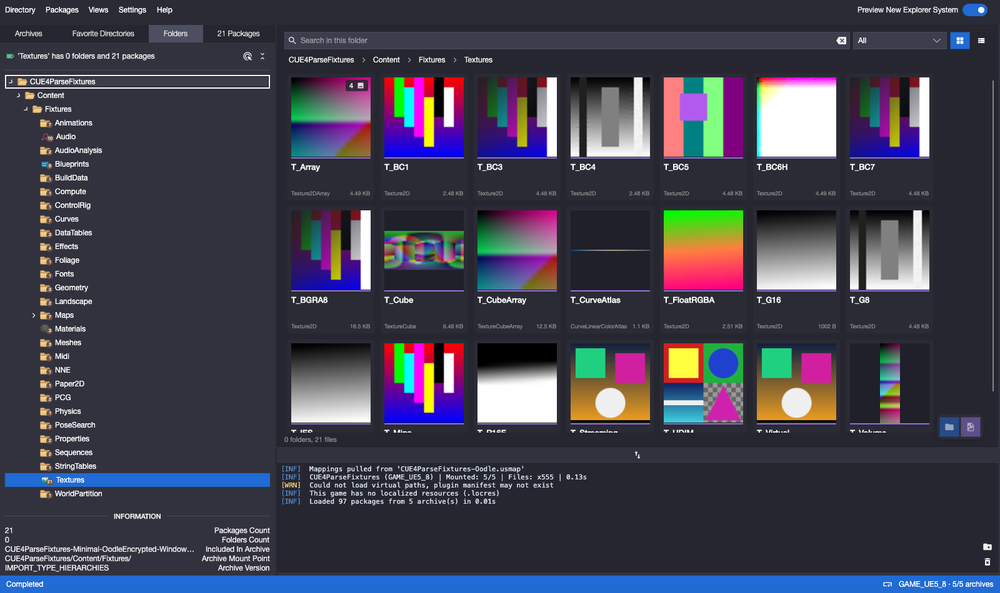

# FModel for macOS

[](https://github.com/arleckk/fmodel-mac/actions/workflows/build.yml)

An **unofficial** native macOS (Apple Silicon) port of [FModel](https://github.com/4sval/FModel), the
archive explorer for Unreal Engine games, built on [CUE4Parse](https://github.com/FabianFG/CUE4Parse)
with an [Avalonia](https://avaloniaui.net) UI. The app is called **FModel** and follows the original's
layout and features as closely as macOS allows.

> This project is not affiliated with or endorsed by the FModel authors or Epic Games. Please report
> problems with this port [here](https://github.com/arleckk/fmodel-mac/issues), not to the original
> FModel.



## Features

- **Explorer:** Pak and IoStore archives (encrypted, compressed, unversioned with mappings), the
  Archives / Favorite Directories / Folders / Packages tabs, FModel's new asset explorer (grid and
  list with thumbnails), search, references and metadata.
- **Games:** profiles (each with its directory, UE version, AES keys, mappings, endpoints, language
  and favorite directories), AES and mappings endpoints (uedb.dev presets), versioning overrides,
  backups and comparison with FModel's online backups.
- **Previews:** properties as JSON, textures, decompiled Blueprints and Lua, localized texts, an
  audio player (Wwise, Bink, ADX/HCA, Opus… through vgmstream) and an image merger.
- **3D viewer** (OpenGL): static and skeletal meshes with PBR materials and normal maps, maps and
  landscapes with their layers, an orbit and a fly camera, animations, blend spaces and morph
  targets, the animations made for a mesh's skeleton with their notifies (sounds played in sync, an
  approximate preview of Niagara and Cascade effects), screenshots and **video export** (MP4/MOV with
  the notify sounds).
- **Export:** raw data, properties, textures, models (glTF, UEFormat…), animations, worlds and audio,
  per package or per folder, through an Export Session window.
- **Command line and MCP server:** `fmodel` lists, searches, reads and exports from the terminal, and
  `fmodel mcp` lets AI assistants (Claude Code, Claude Desktop, any MCP client) browse a game, read its packages
  and textures, and export assets, all with the profiles and settings saved in the app.

The full list, with the design decisions and how each part was verified, is in
[`app/README.md`](app/README.md).

## Requirements

- A Mac with Apple Silicon (arm64).
- To build: the [.NET 10 SDK](https://dotnet.microsoft.com/download), Xcode command line tools
  (`xcode-select --install`), `git` and `cmake` (CUE4Parse's native library is built with it).

There are no prebuilt downloads yet: build it from source as below.

## Building

```bash
git clone https://github.com/arleckk/fmodel-mac.git
cd fmodel-mac
scripts/setup-upstream.sh --with-vgmstream
app/packaging/build-app.sh
```

`setup-upstream.sh` fetches the pinned FModel and CUE4Parse sources into `upstream/` (not tracked)
and applies `patches/CUE4Parse.patch`; `--with-vgmstream` also builds vgmstream for the audio player.
`build-app.sh` produces `app/dist/FModel.app`. `app/packaging/build-unluac.sh` optionally adds the Lua
decompiler. The app is signed ad hoc, so the first time macOS may ask you to confirm opening it
(right-click › Open, or System Settings › Privacy & Security).

Oodle-compressed games need nothing extra: CUE4Parse decompresses Oodle with
[OodleSharp](https://github.com/NotOfficer/OodleSharp) (managed code, MIT), and no Oodle library from
Epic Games Tools is included.

## Command line

The app's executable is also a command-line tool. Put its `fmodel` link on your PATH (zsh):

```bash
echo 'export PATH="/Applications/FModel.app/Contents/Resources/bin:$PATH"' >> ~/.zprofile
```

Open the app once from Finder first, so macOS lets it run. Then:

```bash
fmodel profiles                                  # the games saved in the app; * is the active one
fmodel search Hero_Body                          # find files in the active profile's game
fmodel cat /Game/Characters/Hero/Hero            # a package's properties, as FModel's JSON
fmodel export /Game/Characters/Hero --kind models -p "My Game"   # glTF into ~/Documents/FModel/Output/Exports
fmodel ls -d ~/Games/MyGame/Content/Paks -g GAME_UE5_4 -k 0x… Game/Content     # a game without a profile
```

`fmodel help` lists every command and option. The command line reads the app's profiles and settings
(Settings › Export decides the formats) and never changes them.

## MCP server

`fmodel mcp` is an [MCP](https://modelcontextprotocol.io) server over stdio: an AI assistant can browse a game,
search it, read packages as FModel's JSON, decompile Blueprints, find references, look at textures and export
assets. It mounts the active profile (or `--profile <name>`) and keeps it mounted.

Claude Code:

```bash
claude mcp add fmodel -- /Applications/FModel.app/Contents/MacOS/FModel mcp
```

Claude Desktop and other clients (`claude_desktop_config.json` or the client's equivalent):

```json
{
  "mcpServers": {
    "fmodel": {
      "command": "/Applications/FModel.app/Contents/MacOS/FModel",
      "args": ["mcp"]
    }
  }
}
```

Every tool reads the game except `export_assets`, which writes into the app's output folder (or the folder you
give it).

## Where it keeps things

- Settings, profiles, favorites and caches: `~/Library/Application Support/FModel/`
- Logs: `~/Library/Logs/FModel/` (the command line and the MCP server write `FModel-cli-<date>.log`)
- Exports (by default): `~/Documents/FModel/Output/`

## Repository layout

| Folder | What |
|---|---|
| `app/` | The app (`FModel`), the test harness (`FModel.Snapshot`) and packaging scripts. See `app/README.md`. |
| `poc/` | The first proof of concept (CUE4Parse on macOS). See `poc/README.md`. |
| `patches/` | Our changes to CUE4Parse, applied on top of the pinned commit. |
| `scripts/` | `setup-upstream.sh` recreates the untracked folders; `save-patches.sh` refreshes the patch. |
| `docs/` | Images for this README. |

Not tracked (recreated by the scripts): `upstream/` (FModel at `d615497` with CUE4Parse at
`3fc091a`, plus the patch) and `vendor/` (vgmstream, unluac and their dependencies).

After changing anything under `upstream/CUE4Parse`, run `scripts/save-patches.sh` and commit the patch.

## License and credits

As a derivative of FModel, this project is licensed under the **GNU GPL v3.0** (see
[LICENSE](LICENSE)); third-party components and their licenses are listed in [NOTICE](NOTICE).

- [FModel](https://github.com/4sval/FModel) by 4sval and contributors (GPL-3.0): the features,
  interface and resources (icons, syntax definitions) this port is based on. If you find it useful,
  consider [supporting FModel](https://fmodel.app/donate).
- [CUE4Parse](https://github.com/FabianFG/CUE4Parse) by FabianFG and contributors (Apache-2.0): reads
  the game files; our changes are in `patches/CUE4Parse.patch`.
- [OodleSharp](https://github.com/NotOfficer/OodleSharp) (MIT), [vgmstream](https://github.com/vgmstream/vgmstream),
  [unluac](https://sourceforge.net/projects/unluac/) and the libraries listed in NOTICE.

Unreal Engine is a trademark of Epic Games, Inc. Game files and assets belong to their publishers;
this tool doesn't include any.
